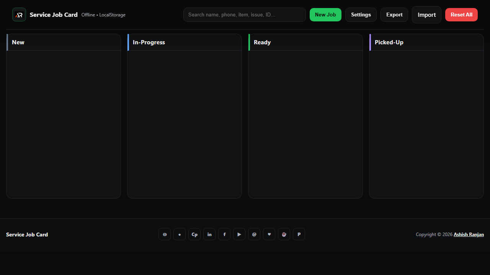

# Service Job Card

A lightweight, local-first service desk for creating and tracking repair jobs in a Kanban workflow.

## Features

- Create, search, edit, and delete service jobs
- Move jobs through New, In-Progress, Ready, and Picked-Up stages
- LocalStorage persistence with JSON import and export
- Billing totals, balance calculation, shop settings, and printable tickets
- Responsive fixed header, icon-only footer links, and floating scroll-to-top control

## Tech stack

HTML, Sass, vanilla JavaScript, and browser LocalStorage.

## Run locally

Open `index.html` with a local server such as VS Code Live Server. To compile Sass:

```bash
sass --watch style.scss style.css
```

## Data and backups

Jobs, drafts, and shop settings are stored in this browser's LocalStorage. They do not sync to another browser or device. Use **Export** to download a JSON backup before clearing browser data.

## Demo

[Open Service Job Card](https://a2rp.github.io/service-job-card/)



## Links

- [Portfolio](https://www.ashishranjan.net/)
- [GitHub](https://github.com/a2rp)
- [CodePen](https://codepen.io/ash1198)
- [LinkedIn](https://www.linkedin.com/in/aashishranjan)
- [Facebook](https://www.facebook.com/theash.ashish/)
- [YouTube](https://www.youtube.com/@ashishranjan-ashz?sub_confirmation=1)
- [Email](mailto:ash.ranjan09@gmail.com)

## Support

- [Support](https://a2rp-donation-page.netlify.app/)
- [Buy Me a Coffee](https://buymeacoffee.com/a2rp)
- [Patreon](https://patreon.com/a2rp)
