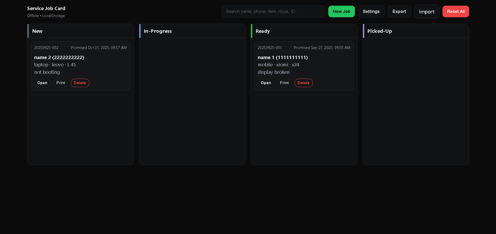

# Service Job Card



Tiny, offline-first web app to create/track repair/service job tickets with printable receipts.

**Live:** https://a2rp.github.io/service-job-card/  
**Code:** https://github.com/a2rp/service-job-card

## Features

-   New job intake → auto ID (`YYYYMMDD-###`)
-   Kanban board: New / In-Progress / Ready / Picked-Up
-   Live totals: **Total (₹)** and **Balance (₹ = Total − Advance)**
-   Print ticket (A5/A6 friendly), shop details in header
-   Search, Export/Import (JSON), LocalStorage-only

## Stack

HTML + SCSS + JavaScript (vanilla). No backend, no frameworks.

## Quick Start

```bash
# 1) Clone
git clone https://github.com/a2rp/service-job-card.git
cd service-job-card

# 2) Compile SCSS → CSS (install Sass if needed: npm i -g sass)
sass --watch style.scss style.css

# 3) Run
# Open index.html in your browser (or use Live Server)
```

## Links

- Portfolio: [https://www.ashishranjan.net](https://www.ashishranjan.net)
- GitHub: [https://github.com/a2rp](https://github.com/a2rp)
- CodePen: [https://codepen.io/ash1198](https://codepen.io/ash1198)
- LinkedIn: [https://www.linkedin.com/in/aashishranjan](https://www.linkedin.com/in/aashishranjan)
- Facebook: [https://www.facebook.com/theash.ashish/](https://www.facebook.com/theash.ashish/)
- YouTube: [https://www.youtube.com/@ashishranjan-ashz?sub_confirmation=1](https://www.youtube.com/@ashishranjan-ashz?sub_confirmation=1)
- Email: [ash.ranjan09@gmail.com](mailto:ash.ranjan09@gmail.com)

## Support

- Support: [https://a2rp-donation-page.netlify.app/](https://a2rp-donation-page.netlify.app/)
- Buy Me A Coffee: [https://buymeacoffee.com/a2rp](https://buymeacoffee.com/a2rp)
- Patreon: [https://patreon.com/a2rp](https://patreon.com/a2rp)
<!-- Project links -->

## Links

- Live: [https://a2rp.github.io/service-job-card/](https://a2rp.github.io/service-job-card/)
- Repository: [https://github.com/a2rp/service-job-card](https://github.com/a2rp/service-job-card)
- Portfolio: [https://www.ashishranjan.net/](https://www.ashishranjan.net/)
- GitHub: [https://github.com/a2rp](https://github.com/a2rp)
- CodePen: [https://codepen.io/ash1198](https://codepen.io/ash1198)
- LinkedIn: [https://www.linkedin.com/in/aashishranjan](https://www.linkedin.com/in/aashishranjan)
- Facebook: [https://www.facebook.com/theash.ashish/](https://www.facebook.com/theash.ashish/)
- YouTube: [https://www.youtube.com/@ashishranjan-ashz?sub_confirmation=1](https://www.youtube.com/@ashishranjan-ashz?sub_confirmation=1)
- Email: [ash.ranjan09@gmail.com](mailto:ash.ranjan09@gmail.com)

## Support

- Support: [https://a2rp-donation-page.netlify.app/](https://a2rp-donation-page.netlify.app/)
- Buy Me a Coffee: [https://buymeacoffee.com/a2rp](https://buymeacoffee.com/a2rp)
- Patreon: [https://www.patreon.com/a2rp](https://www.patreon.com/a2rp)
